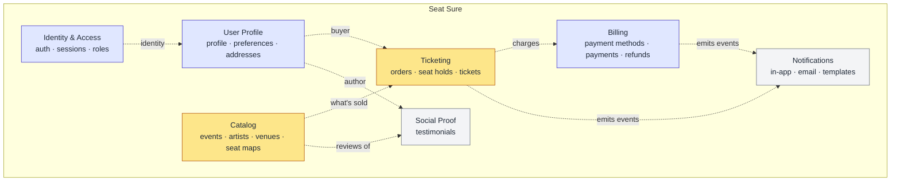

# Bounded Contexts & Data Model

Proposed bounded-context layout derived from the product's feature list, followed by tables and their key fields per context. The split is intentionally pragmatic (few, focused contexts) rather than one BC per aggregate — further splits can happen as complexity grows.

## Context Map



Amber = core domain (what the business sells), indigo = supporting, gray = generic. Dashed arrows are event / reference flows across contexts, not shared tables.

## Feature → Context Mapping

| Feature | Context |
|---|---|
| Consulta de Eventos | Catalog |
| Consulta de Artistas (Cantores) | Catalog |
| Consulta de Testimonials | Social Proof |
| Criação e edição de Artistas | Catalog |
| Criação e Edição de Testimonials | Social Proof |
| Criação e Edição de Eventos | Catalog |
| Consulta de eventos perto de você | Catalog |
| Compra de Ingresso | Ticketing |
| Escolha de assento | Ticketing |
| Cadastro | Identity & Access |
| Login | Identity & Access |
| Pagamento | Billing |
| Consulta de Status do Ingresso | Ticketing |
| Baixar o Ingresso | Ticketing |
| Alteração de usuário | Identity & Access + User Profile |
| Cadastro e edição de Pagamento | Billing |
| Notificações (In App, Email) | Notifications |
| Configurações (Linguagem) | User Profile |

## Bounded Contexts

| # | Context | Owns | Why it exists |
|---|---|---|---|
| 1 | **Identity & Access** | Sign-up, login, credentials, sessions, roles | Auth is a supporting domain; isolate it so you can swap providers (Auth0, Cognito) later. |
| 2 | **User Profile** | Personal info, language/config, preferences | The user *account* (auth) and the user *profile* (name, avatar, preferences) change for different reasons and by different actors. |
| 3 | **Catalog** | Events, Artists, Venues, Seat Maps | Read-heavy. All "consultation" flows read from here. Includes geolocation. |
| 4 | **Ticketing** | Seat reservation, ticket issuance, ticket status, PDF/QR | Core domain — this is what the business sells. |
| 5 | **Billing** | Payment methods, charges, refunds, invoices | Sensitive/regulated; belongs behind its own boundary (often a gateway like Stripe). |
| 6 | **Social Proof** | Testimonials/Reviews | Not on the transactional path; read-heavy, moderatable. |
| 7 | **Notifications** | In-app + email templates, delivery log, subscriptions | Cross-cutting; every BC emits events, this BC listens. |

### Notes on the mapping

- **Artists** were moved out of "Events" into a broader **Catalog** BC. An `Artist` is its own aggregate (has bio, photos, may appear in many events). "Events" as a *module name* is fine, but the *context* is really "what we sell".
- **Seat/Venue** could be its own BC if seating gets complex (dynamic pricing, sections, holds). Start it inside Catalog and extract later.
- **Config (Linguagem)** lives in User Profile as `preferences` — not its own BC.

---

## Tables

### 1. Identity & Access

```
users_auth
  id (uuid, pk)
  email (unique, citext)
  password_hash
  email_verified_at
  status (active|disabled|locked)
  last_login_at
  created_at, updated_at

sessions
  id (uuid, pk)
  user_auth_id (fk)
  refresh_token_hash
  user_agent, ip
  expires_at, revoked_at, created_at

roles                              role_assignments
  id, name (admin|customer|...)    user_auth_id, role_id, granted_at
```

### 2. User Profile

```
users
  id (uuid, pk)                 -- 1:1 with users_auth.id
  display_name
  full_name
  avatar_url
  phone
  birth_date
  document_id (CPF/etc, encrypted)
  created_at, updated_at

user_preferences
  user_id (pk, fk)
  language (pt-BR|en-US|...)
  timezone
  notification_channels (jsonb: {email:true, in_app:true, push:false})
  updated_at

addresses
  id, user_id, label, line1, line2, city, state, country, postal_code, is_default
```

### 3. Catalog (Events / Artists / Venues)

```
artists
  id (uuid, pk)
  stage_name (unique)
  slug (unique)
  bio (text)
  cover_image_url
  genres (text[])
  created_at, updated_at

venues
  id, name, address, city, state, country
  latitude, longitude              -- for "events near you"
  capacity
  seat_map_id (nullable)

seat_maps                          seats
  id, venue_id, name, layout(jsonb)  id, seat_map_id, section, row, number, category

events
  id (uuid, pk)
  title, slug (unique)
  description (text)
  cover_image_url
  venue_id (fk)
  starts_at, ends_at (timestamptz)
  doors_open_at
  status (draft|published|cancelled|sold_out|finished)
  latitude, longitude              -- denormalized from venue for fast geo queries
  created_by (user_id)
  created_at, updated_at
  INDEX geo (latitude, longitude) or PostGIS geography column

event_artists                      -- many-to-many
  event_id, artist_id, headliner (bool), performance_order

ticket_types                       -- price tiers per event
  id, event_id, name (VIP|Pista|...), price_cents, currency, seat_category, quantity_total
```

### 4. Ticketing

```
orders                             -- purchase intent / cart
  id, user_id, event_id
  status (pending|paid|failed|cancelled|refunded)
  subtotal_cents, fee_cents, total_cents, currency
  payment_id (fk billing.payments, nullable)
  created_at, paid_at

order_items
  id, order_id, ticket_type_id, seat_id (nullable), unit_price_cents, quantity

seat_holds                         -- temporary lock during checkout
  id, event_id, seat_id, user_id, expires_at
  UNIQUE(event_id, seat_id)

tickets                            -- issued after payment
  id (uuid, pk)
  order_item_id (fk)
  event_id, user_id
  seat_id (nullable for GA)
  code (unique, opaque)            -- for QR
  status (issued|used|cancelled|refunded|transferred)
  issued_at, used_at
  pdf_url (or generate on demand)
```

### 5. Billing

```
payment_methods
  id, user_id
  provider (stripe|mercadopago|...)
  provider_customer_id
  brand, last4, exp_month, exp_year
  is_default, created_at

payments
  id, user_id, order_id
  provider, provider_payment_id
  amount_cents, currency
  status (requires_action|processing|succeeded|failed|refunded)
  method_snapshot (jsonb)
  created_at, updated_at

refunds
  id, payment_id, amount_cents, reason, status, created_at
```

### 6. Social Proof

```
testimonials
  id, user_id
  event_id (nullable)              -- allow site-wide OR event-specific
  rating (1–5, nullable)
  title, body
  status (pending|approved|rejected)
  approved_by, approved_at
  created_at, updated_at
```

### 7. Notifications

```
notifications
  id, user_id
  channel (email|in_app|push)
  template_key (order.paid, ticket.issued, event.reminder, ...)
  payload (jsonb)
  status (queued|sent|failed|read)
  sent_at, read_at, created_at

notification_templates
  key (pk), channel, language, subject, body_template, updated_at
```

---

## Tradeoffs to Revisit

- **User table split (`users_auth` vs `users`)** — cleaner boundary but adds a join on every request. If shipping solo and fast, one `users` table is fine; split when the auth story gets non-trivial.
- **Seat holds vs optimistic locking** — the `seat_holds` table with TTL is simplest. If concurrency gets heavy, move to Redis with expiry.
- **Geo queries** — start with `(lat, lng)` columns + a bounding-box filter. Move to PostGIS when "near me" becomes a real feature with distance sorting.
- **Testimonials tied to `event_id`** — nullable lets you keep both site-wide and per-event reviews without two tables.

---

## Entity Relationships (Catalog + Ticketing + Billing)

Focused on the transactional path (what powers the event detail + seat selection + checkout). Identity & Access, Social Proof and Notifications are omitted here — their tables are described above.

```mermaid
erDiagram
    USER ||--o{ ORDER : places
    USER ||--o{ PAYMENT_METHOD : owns
    USER ||--o{ TICKET : holds

    VENUE ||--o{ SEAT_MAP : "has configurations"
    SEAT_MAP ||--o{ SEAT : contains
    SEAT_MAP ||--o{ EVENT : "used by"

    EVENT }o--|| VENUE : "held at"
    EVENT ||--o{ EVENT_ARTIST : features
    ARTIST ||--o{ EVENT_ARTIST : "performs in"

    EVENT ||--o{ TICKET_TYPE : "sells as"
    TICKET_TYPE }o--o{ SEAT : "priced for (by category)"

    EVENT ||--o{ ORDER : "purchased for"
    ORDER ||--|{ ORDER_ITEM : contains
    TICKET_TYPE ||--o{ ORDER_ITEM : "picked as"
    SEAT ||--o{ ORDER_ITEM : "reserves (nullable for GA)"

    EVENT ||--o{ SEAT_HOLD : "locks during checkout"
    SEAT ||--o{ SEAT_HOLD : "temporarily held"
    USER ||--o{ SEAT_HOLD : "held by"

    ORDER_ITEM ||--o| TICKET : "issued as"
    PAYMENT_METHOD ||--o{ PAYMENT : "used for"
    ORDER ||--o| PAYMENT : "paid by"
    PAYMENT ||--o{ REFUND : "refunded via"

    VENUE {
        uuid id PK
        string name
        string address
        string city
        string country
        decimal latitude
        decimal longitude
        int capacity
    }
    SEAT_MAP {
        uuid id PK
        uuid venueId FK
        string name
        jsonb layout "viewBox · sections polygons · stage"
    }
    SEAT {
        uuid id PK
        uuid seatMapId FK
        string section
        string row
        string number
        string category "VIP · Ouro · Prata · Bronze"
        float x
        float y
    }
    ARTIST {
        uuid id PK
        string stageName
        string slug
        text bio
    }
    EVENT {
        uuid id PK
        string slug UK
        string name
        text description
        uuid venueId FK
        uuid seatMapId FK
        timestamp startAt
        timestamp endsAt
        enum status
    }
    EVENT_ARTIST {
        uuid eventId FK
        uuid artistId FK
        bool headliner
    }
    TICKET_TYPE {
        uuid id PK
        uuid eventId FK
        string name "VIP · Pista · ..."
        string seatCategory "nullable for GA"
        int priceCents
        string currency
        int quantityTotal
        int maxPerOrder
    }
    ORDER {
        uuid id PK
        uuid userId FK
        uuid eventId FK
        enum status
        int totalCents
    }
    ORDER_ITEM {
        uuid id PK
        uuid orderId FK
        uuid ticketTypeId FK
        uuid seatId FK "nullable"
        int unitPriceCents
    }
    SEAT_HOLD {
        uuid id PK
        uuid eventId FK
        uuid seatId FK
        uuid userId FK
        timestamp expiresAt
    }
    TICKET {
        uuid id PK
        uuid orderItemId FK
        uuid eventId FK
        uuid userId FK
        uuid seatId FK "nullable"
        string code UK
        enum status
    }
    PAYMENT_METHOD {
        uuid id PK
        uuid userId FK
        string provider
    }
    PAYMENT {
        uuid id PK
        uuid orderId FK
        uuid paymentMethodId FK
        int amountCents
        enum status
    }
    REFUND {
        uuid id PK
        uuid paymentId FK
        int amountCents
    }
```



### Key relationships to remember

- **Venue → SeatMap (1:N):** one venue, many configurations (concert / theater / sports).
- **SeatMap → Seat (1:N):** the map's physical seats — reused across events.
- **Event → SeatMap (N:1):** the event locks in *which* configuration it's selling.
- **Event → TicketType (1:N):** commercial tiers for this specific event; carry prices and sales rules.
- **TicketType ↔ Seat:** logical link via `seatCategory` matching `Seat.category` — no hard FK, because a `TicketType` can be GA (no seats).
- **SeatHold:** the concurrency guard. `UNIQUE(eventId, seatId)` prevents two carts holding the same seat.
- **OrderItem → Ticket (1:0..1):** the ticket only materializes after payment succeeds.
