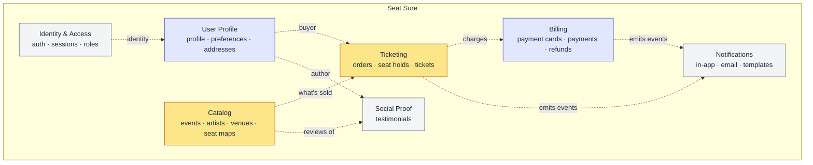
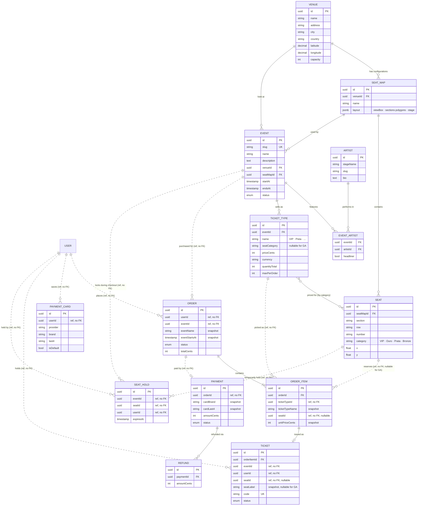

# Bounded Contexts & Data Model

Proposed bounded-context layout derived from the product's feature list, followed by tables and their key fields per context. The split is intentionally pragmatic (few, focused contexts) rather than one BC per aggregate — further splits can happen as complexity grows.

## Context Map



Amber = core domain (what the business sells), indigo = supporting, gray = generic. Dashed arrows are event / reference flows across contexts, not shared tables.

## Feature → Context Mapping

| Feature | Context |
|---|---|
| Consulta de Eventos | Catalog |
| Consulta de Artistas (Cantores) | Catalog |
| Consulta de Testimonials | Social Proof |
| Criação e edição de Artistas | Catalog |
| Criação e Edição de Testimonials | Social Proof |
| Criação e Edição de Eventos | Catalog |
| Consulta de eventos perto de você | Catalog |
| Compra de Ingresso | Ticketing |
| Escolha de assento | Ticketing |
| Cadastro | Identity & Access |
| Login | Identity & Access |
| Pagamento | Billing |
| Consulta de Status do Ingresso | Ticketing |
| Baixar o Ingresso | Ticketing |
| Alteração de usuário | Identity & Access + User Profile |
| Cadastro e edição de Pagamento | Billing |
| Notificações (In App, Email) | Notifications |
| Configurações (Linguagem) | User Profile |

## Bounded Contexts

| # | Context | Owns | Why it exists |
|---|---|---|---|
| 1 | **Identity & Access** | Sign-up, login, credentials, sessions, roles | Generic subdomain: no competitive advantage and no business-specific knowledge, so isolate it and you can swap providers (Auth0, Cognito) later. |
| 2 | **User Profile** | Personal info, language/config, preferences | Supporting subdomain: no competitive advantage on its own, but `document_id` and `notification_channels` need business-specific knowledge of the ticket-buying journey. The user *account* (auth) and the user *profile* (name, avatar, preferences) also change for different reasons and by different actors. |
| 3 | **Catalog** | Events, Artists, Venues, Seat Maps | Read-heavy. All "consultation" flows read from here. Includes geolocation. |
| 4 | **Ticketing** | Seat reservation, ticket issuance, ticket status, PDF/QR | Core domain — this is what the business sells. |
| 5 | **Billing** | Payment methods, charges, refunds, invoices | Sensitive/regulated; belongs behind its own boundary (often a gateway like Stripe). |
| 6 | **Social Proof** | Testimonials/Reviews | Not on the transactional path; read-heavy, moderatable. |
| 7 | **Notifications** | In-app + email templates, delivery log, subscriptions | Cross-cutting; every BC emits events, this BC listens. |

### Notes on the mapping

- **Artists** were moved out of "Events" into a broader **Catalog** BC. An `Artist` is its own aggregate (has bio, photos, may appear in many events). "Events" as a *module name* is fine, but the *context* is really "what we sell".
- **Seat/Venue** could be its own BC if seating gets complex (dynamic pricing, sections, holds). Start it inside Catalog and extract later.
- **Config (Linguagem)** lives in User Profile as `preferences` — not its own BC.

---

## Ubiquitous Language

One glossary per context, key terms only. The same term can mean something different in each context; see [`ddd-strategic-design-theory.md`](../../apps/api/docs/ddd-strategic-design-theory.md#ubiquitous-language) for why that's expected, not a bug.

### 1. Identity & Access

- **user**: the login identity: email, password hash, and whether the email is verified. Table `users_auth` (`IdentityUser`).
- **session**: one sign-in, tied to a refresh token, with its own expiry ("Remember me": 30 days, otherwise 24 hours) and revocation. Requests carry a short-lived access token (JWT) that names the session ([ADR-016](../adrs/016-sessions-as-jwt-access-and-rotating-refresh-tokens-in-httponly-cookies.md)).
- **verification code**: a 6-digit, single-use code sent by email to verify the address or to start a password reset. Valid for 10 minutes.
- **reset grant**: what a confirmed reset code buys: one password change within 10 minutes.
- **lockout**: after 5 failed logins for an email within 15 minutes, every login for it is refused for 15 minutes.
- **role**: a permission grant (`admin`, `customer`, ...) assigned to a user. Not built yet.

### 2. User Profile

- **user**: the person behind an account: first and last name, avatar, phone, and birth date. Table `users` (`UserProfileUser`), a separate row from `users_auth` (Identity & Access) with the same id, because it changes for different reasons and by a different actor. Created at signup through User Profile's public API.
- **preferences**: language, timezone, and notification channel choices, stored per user.
- **address**: a saved, labeled address, one of which can be the default.

### 3. Catalog

- **event**: a show at one venue at one time: a concert, sports match, or festival. Owned here as `events`. Not an async message; see Notifications below.
- **artist**: a performer, with a bio and genres, who can appear in many events.
- **venue**: a real place with an address and coordinates. One venue can host several seat map configurations.
- **seat map**: a venue's layout for one configuration, drawn as sections with a stage and a view box.
- **seat**: a fixed position on a seat map: section, row, number, category, and coordinates. It carries no availability state; that's Ticketing's language.
- **ticket type**: a price tier for one event's section (name, price, currency), not the ticket itself.

### 4. Ticketing

- **event**: not owned here. A plain reference to Catalog's event, kept with a name and start-time snapshot so an order still reads correctly if the Catalog event changes later.
- **user**: the buyer: whoever holds seats, places the order, and owns the resulting tickets. A plain reference to User Profile.
- **seat**: availability for one event, not a position: free, held, or sold. The same seat (Catalog's `seat_id`) means something different at each stage of the purchase.
- **seat hold**: a temporary claim on one seat for one event, released automatically once it expires ([ADR-015](../adrs/015-seat-holds-owned-by-ticketing.md)).
- **order**: a purchase intent, from cart to paid, failed, cancelled, or refunded.
- **ticket**: the artifact issued after payment, identified by its code, checked at the door.

### 5. Billing

- **user**: the account being charged. A plain reference to User Profile.
- **order**: not owned here. A plain reference to Ticketing's order being paid.
- **payment method**: a stored way to charge a user, through a provider. Only cards exist today.
- **payment card**: a card saved for a user. Billing keeps the gateway token and display data (brand, last 4, expiry, holder), never the number or CVV ([ADR-020](../adrs/020-saved-cards-as-gateway-tokens.md)).
- **card attempt lock**: a 15-minute block on adding cards and on saved-card charges for a user with 5 failed card attempts in 15 minutes ([ADR-021](../adrs/021-card-operations-throttled-per-user-in-billing.md)).
- **payment**: one charge attempt against an order, with a status independent of the order's own status.
- **refund**: money returned against a completed payment.

### 6. Social Proof

- **user**: the author of a testimonial. A plain reference to User Profile.
- **event**: the subject of a testimonial, or none for a site-wide one. A plain reference to Catalog's event.
- **testimonial**: a rating and/or written review, moderated before it's shown.

### 7. Notifications

- **user**: the recipient of a notification. A plain reference to User Profile.
- **seat**: not a reference to Catalog or Ticketing data, just text copied into a message payload (for example, "Section B, row 4, seat 12").
- **event**: not a term used here. A `template_key` names the fact that happened (`order.paid`, `ticket.issued`), so it isn't confused with Catalog's event (a show).
- **notification**: one delivery attempt on one channel (email, in-app, push), tracked from queued to sent, read, or failed.
- **template**: the reusable content for a `template_key`, one per channel and language.

---

## Tables

Legend: `fk` is a foreign key inside the same context. `ref, no FK` is a plain ID column pointing at another context's table (ADR-006); the target context is named next to it.

### 1. Identity & Access

```
users_auth                         -- IdentityUser
  id (uuid, pk)
  email (unique, stored trimmed + lowercased)
  password_hash                    -- bcrypt
  email_verified_at
  last_login_at
  created_at, updated_at

sessions                           -- IdentitySession (ADR-016)
  id (uuid, pk)                    -- the access token's `sid`
  user_auth_id (fk)
  refresh_token_hash (unique)      -- SHA-256; replaced on every refresh
  previous_refresh_token_hash      -- accepted for 30 s after a refresh
  rotated_at
  persistent                       -- "Remember me"
  expires_at, revoked_at, created_at

verification_codes                 -- IdentityVerificationCode
  id, user_auth_id (fk)
  purpose (verify_email|reset_password)
  code_hash                        -- bcrypt of the 6 digits
  expires_at                       -- sent + 10 min
  failed_attempts                  -- the code stops working at 5
  consumed_at, invalidated_at, created_at

password_reset_grants              -- IdentityPasswordResetGrant
  id, user_auth_id (fk)
  token_hash (unique)              -- SHA-256
  expires_at, used_at

login_throttles                    -- IdentityLoginThrottle
  id, email (unique)               -- may have no account (no enumeration)
  failed_count, window_started_at, locked_until

roles                              role_assignments          -- not built yet
  id, name (admin|customer|...)    user_auth_id, role_id, granted_at
```

Not built yet from the original sketch: `users_auth.status` (the lockout lives in `login_throttles`), `sessions.user_agent` / `ip`, and roles.

### 2. User Profile

```
users                           -- UserProfileUser
  id (uuid, pk)                 -- 1:1 with users_auth.id (ref Identity & Access, no FK)
  first_name, last_name         -- from signup, 50 chars max
  display_name
  avatar_url
  phone
  birth_date
  document_id (CPF/etc, encrypted)
  created_at, updated_at

user_preferences
  user_id (pk, fk)
  language (pt-BR|en-US|...)
  timezone
  notification_channels (jsonb: {email:true, in_app:true, push:false})
  updated_at

addresses
  id, user_id, label, line1, line2, city, state, country, postal_code, is_default
```

### 3. Catalog (Events / Artists / Venues)

```
artists
  id (uuid, pk)
  stage_name (unique)
  slug (unique)
  bio (text)
  cover_image_url
  genres (text[])
  created_at, updated_at

venues
  id, name, address, city, state, country
  latitude, longitude              -- for "events near you"
  capacity
  seat_map_id (nullable)

seat_maps                          seats
  id, venue_id, name, layout(jsonb)  id, seat_map_id, section, row, number, category

events
  id (uuid, pk)
  title, slug (unique)
  description (text)
  cover_image_url
  venue_id (fk)
  starts_at, ends_at (timestamptz)
  doors_open_at
  status (draft|published|cancelled|sold_out|finished)
  latitude, longitude              -- denormalized from venue for fast geo queries
  created_by (user_id, ref User Profile, no FK)
  created_at, updated_at
  INDEX geo (latitude, longitude) or PostGIS geography column

event_artists                      -- many-to-many
  event_id, artist_id, headliner (bool), performance_order

ticket_types                       -- price tiers per event
  id, event_id, name (VIP|Pista|...), price_cents, currency, seat_category, quantity_total
```

### 4. Ticketing

```
orders                             -- purchase intent / cart
  id
  user_id (ref User Profile, no FK)
  event_id (ref Catalog, no FK)
  event_name, event_starts_at      -- replicated from Catalog, snapshot at order creation
  status (pending|paid|failed|cancelled|refunded)
  subtotal_cents, fee_cents, total_cents, currency
  payment_id (ref Billing, no FK, nullable)
  created_at, paid_at

order_items
  id, order_id
  ticket_type_id (ref Catalog, no FK)
  ticket_type_name                 -- replicated from Catalog, snapshot
  seat_id (ref Catalog, no FK, nullable)
  unit_price_cents                 -- snapshot at purchase time, not a live Catalog price
  quantity

seat_holds                         -- temporary lock during checkout
  id
  event_id (ref Catalog, no FK)
  seat_id (ref Catalog, no FK)
  user_id (ref User Profile, no FK)
  expires_at
  UNIQUE(event_id, seat_id)

tickets                            -- issued after payment
  id (uuid, pk)
  order_item_id (fk)
  event_id (ref Catalog, no FK), user_id (ref User Profile, no FK)
  seat_id (ref Catalog, no FK, nullable for GA)
  seat_label                       -- replicated from Catalog, snapshot for the printed ticket
  code (unique, opaque)            -- for QR
  status (issued|used|cancelled|refunded|transferred)
  issued_at, used_at
  pdf_url (or generate on demand)
```

### 5. Billing

```
payment_cards                      -- BillingPaymentCard
  id
  user_id (ref User Profile, no FK)
  provider                         -- 'simulated' today
  provider_token                   -- never returned or logged
  fingerprint                      -- HMAC of the number, unique per user, never returned
  brand, last4, exp_month, exp_year, holder
  is_default                       -- at most one per user (partial unique index)
  created_at, updated_at           -- hard delete, no deleted_at

card_throttles                     -- BillingCardThrottle
  id, user_id (unique, ref User Profile, no FK)
  failed_count, window_started_at, locked_until

payments
  id
  user_id (ref User Profile, no FK)
  order_id (ref Ticketing, no FK)
  provider, provider_payment_id
  amount_cents, currency
  status (requires_action|processing|succeeded|failed|refunded)
  card_brand, card_last4           -- snapshot; survives the card being removed
  created_at, updated_at

refunds
  id, payment_id, amount_cents, reason, status, created_at
```

### 6. Social Proof

```
testimonials
  id
  user_id (ref User Profile, no FK)
  event_id (ref Catalog, no FK, nullable)  -- allow site-wide OR event-specific
  rating (1–5, nullable)
  title, body
  status (pending|approved|rejected)
  approved_by (ref User Profile, no FK), approved_at
  created_at, updated_at
```

### 7. Notifications

```
notifications
  id
  user_id (ref User Profile, no FK)
  channel (email|in_app|push)
  template_key (order.paid, ticket.issued, event.reminder, ...)
  payload (jsonb)
  status (queued|sent|failed|read)
  sent_at, read_at, created_at

notification_templates
  key (pk), channel, language, subject, body_template, updated_at
```

---

## Tradeoffs to Revisit

- **User table split (`users_auth` vs `users`)** — decided with login/signup: two modules, same id. There is no join per request, because the access token carries the user id ([ADR-016](../adrs/016-sessions-as-jwt-access-and-rotating-refresh-tokens-in-httponly-cookies.md)); only `me` reads both, through User Profile's public API. Signup writes both without a shared transaction: Identity deletes the new account if the profile insert fails. A crash between the two writes can still leave an account without a profile.
- **Seat holds vs optimistic locking** — the `seat_holds` table with TTL is simplest. If concurrency gets heavy, move to Redis with expiry.
- **Geo queries** — start with `(lat, lng)` columns + a bounding-box filter. Move to PostGIS when "near me" becomes a real feature with distance sorting.
- **Testimonials tied to `event_id`** — nullable lets you keep both site-wide and per-event reviews without two tables.

---

## Entity Relationships (Catalog + Ticketing + Billing)

Focused on the transactional path (what powers the event detail + seat selection + checkout). Identity & Access, Social Proof and Notifications are omitted here — their tables are described above.

Legend: solid lines are in-context FKs; dotted lines (`..`) are cross-context references, and their attributes read `ref, no FK` instead of `FK`.



### Key relationships to remember

- **Venue → SeatMap (1:N):** one venue, many configurations (concert / theater / sports).
- **SeatMap → Seat (1:N):** the map's physical seats — reused across events.
- **Event → SeatMap (N:1):** the event locks in *which* configuration it's selling.
- **Event → TicketType (1:N):** commercial tiers for this specific event; carry prices and sales rules.
- **TicketType ↔ Seat:** logical link via `seatCategory` matching `Seat.category` — no hard FK, because a `TicketType` can be GA (no seats).
- **SeatHold:** the concurrency guard. `UNIQUE(eventId, seatId)` prevents two carts holding the same seat.
- **OrderItem → Ticket (1:0..1):** the ticket only materializes after payment succeeds.
