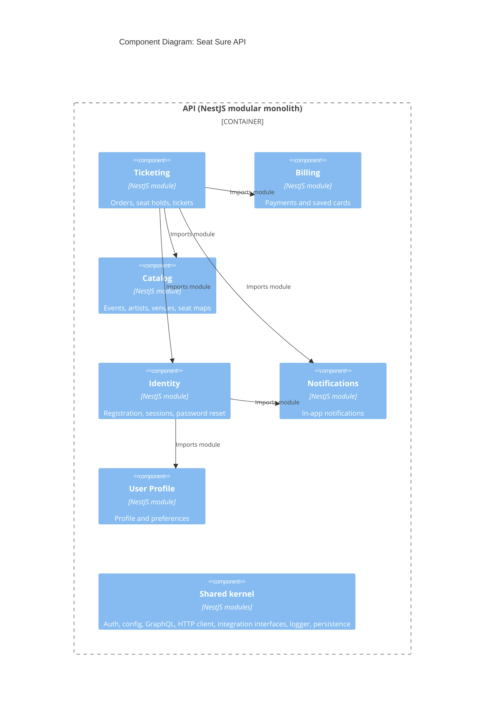

# C4 Level 3: API Components

The bounded contexts inside the API container. There is one component per directory in `apps/api/src/module`, plus the shared kernel. Component ids are the directory names.

## Sources

- Relationships come from the `imports` array of each `*.module.ts` in `apps/api/src/module`:
  - `ticketing.module.ts` imports `CatalogModule`, `BillingModule`, `IdentityModule`, `NotificationsModule`.
  - `identity.module.ts` imports `UserProfileModule` and `NotificationsModule`.
  - `billing.module.ts`, `catalog.module.ts`, `notifications.module.ts`, and `user-profile.module.ts` import no other bounded-context module.
- Billing, identity, notifications, ticketing, and user-profile import `AuthModule` from the shared kernel; billing, identity, and ticketing also import `LoggerModule`. Those arrows are left out to keep the diagram readable.
- Modules reference each other's data by plain ids, never by joins: [ADR-006](../../adrs/006-modular-monolith-with-state-isolation-per-bounded-context.md). Catalog owns ticket types and seat maps: [ADR-011](../../adrs/011-catalog-owns-ticket-types-and-seat-maps.md). Ticketing owns seat holds: [ADR-015](../../adrs/015-seat-holds-owned-by-ticketing.md).
- Social Proof is a bounded context in [bounded-contexts.md](../bounded-contexts.md) with no module yet, so it is not shown.
- Previous level: [container diagram](./container.md).
