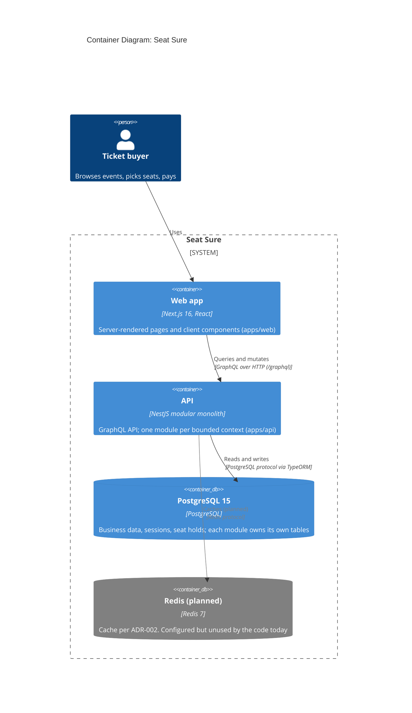

# C4 Level 2: Containers

The deployable pieces of Seat Sure and how they talk. Elements tagged `planned` have no code or config in the repo yet.

## Sources

- Web calls `${apiUrl}/graphql` (`apps/web/src/lib/graphql-server.ts`, `apps/web/src/lib/apollo-client.ts`). GraphQL is the primary API: [ADR-001](../../adrs/001-graphql-primary-api-with-rest-for-specialized-endpoints.md).
- The API is a NestJS modular monolith: [ADR-005](../../adrs/005-nestjs-as-backend-framework.md), [ADR-006](../../adrs/006-modular-monolith-with-state-isolation-per-bounded-context.md).
- Each module builds a TypeORM data source with `type: 'postgres'` (`apps/api/src/module/*/persistence/typeorm-datasource.factory.ts`). The image is `postgres:15-alpine` (`apps/api/docker-compose.yml`).
- Redis is `planned`: the compose service is commented out, the config schema only reads `REDIS_HOST` and `REDIS_PORT` (`apps/api/src/module/shared/module/config/util/config.schema.ts`), and no source file creates a Redis client (`bullmq` is listed in `apps/api/package.json` but nothing under `apps/api/src` imports it). [ADR-002](../../adrs/002-postgresql-and-redis-as-database-stack.md) describes the intended use, and sessions and seat holds ended up in PostgreSQL instead.
- Previous level: [context diagram](./context.md). Next level: [component diagram](./component.md).
