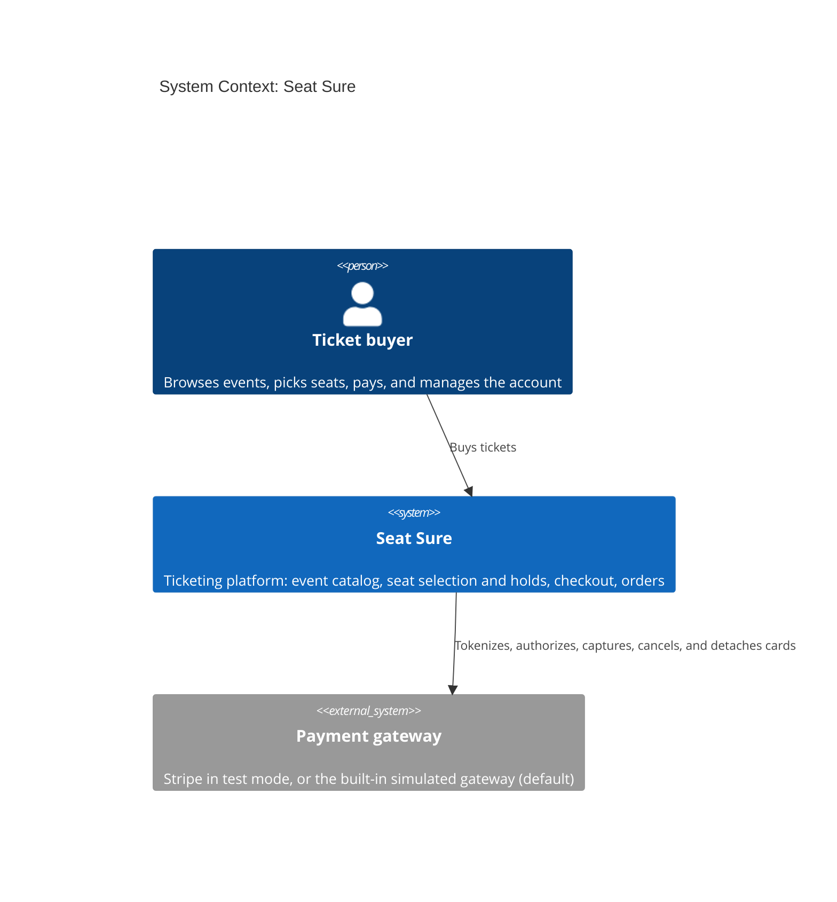

# C4 Level 1: System Context

Who uses Seat Sure and which external system it depends on. Elements tagged `planned` have no code or config in the repo yet.

## Sources

- The billing module defines the `PaymentGateway` port and picks its adapter from `BILLING_GATEWAY` (`apps/api/src/module/billing/billing.module.ts`): `SimulatedPaymentGateway` by default, or `StripePaymentGateway` in Stripe test mode. Live keys are rejected at startup, and the hosted demo stays on the simulated gateway.
- Charges are authorized, then captured after the tickets are issued, and can pause on 3-D Secure: [ADR-024](../../adrs/024-charges-authorized-then-captured-with-3-d-secure.md).
- Saved cards are gateway tokens: [ADR-020](../../adrs/020-saved-cards-as-gateway-tokens.md).
- Next level: [container diagram](./container.md).
