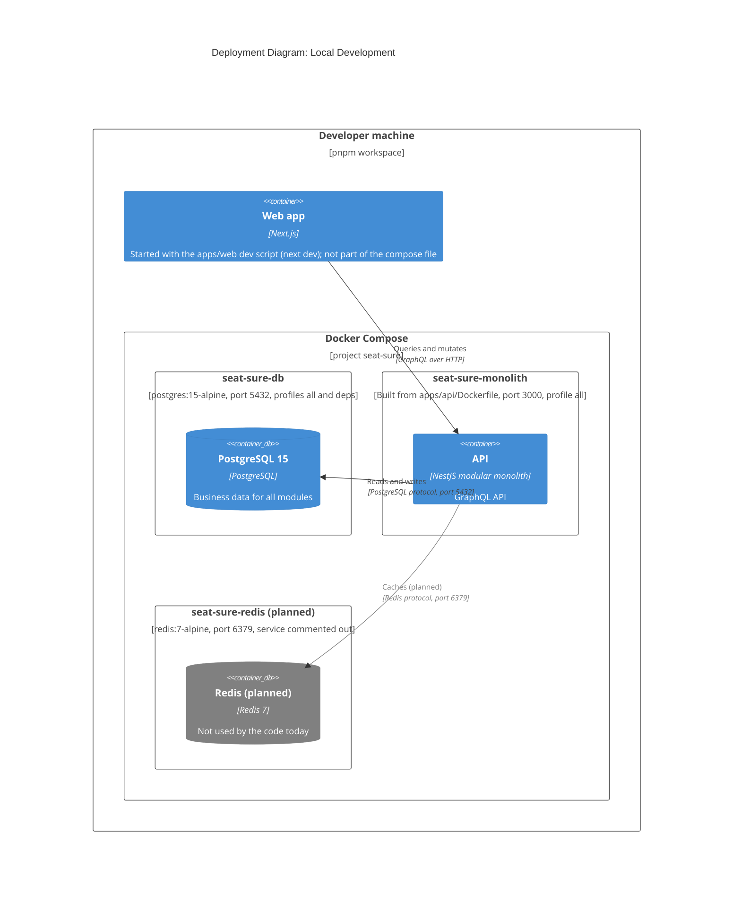

# C4 Deployment: Local Development

The local topology that the repo configures, from `apps/api/docker-compose.yml`. No hosted environment is configured in the repo, so none is drawn. Elements tagged `planned` have no active config yet.

## Sources

- `apps/api/docker-compose.yml` defines the `db` service (`postgres:15-alpine`, `5432:5432`, profiles `all` and `deps`) and the `monolith` service (built from `apps/api/Dockerfile`, `3000:3000`, profile `all`, `depends_on` the database).
- The `redis` service (`redis:7-alpine`, `6379:6379`) is commented out in the compose file, so Redis is `planned`. The `monolith` service already sets `REDIS_HOST` and `REDIS_PORT`.
- With the `deps` profile only the database runs, and the API can then run on the host with `nest start --watch` (`apps/api/package.json`).
- The web app has no compose service. Its `dev` script is `next dev` (`apps/web/package.json`).
- Containers and modules: [container diagram](./container.md), [component diagram](./component.md).
